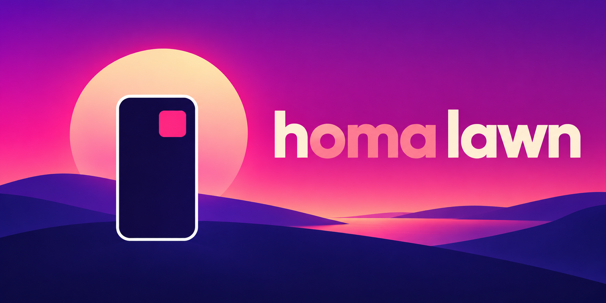
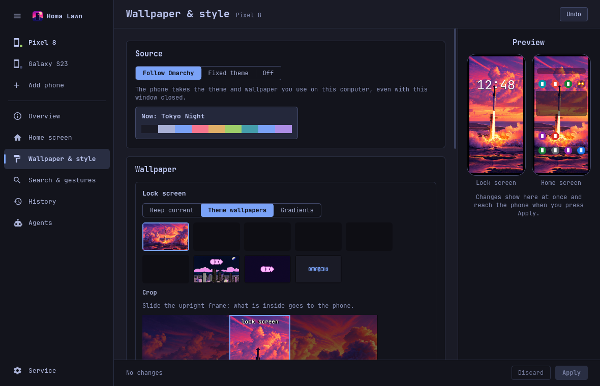
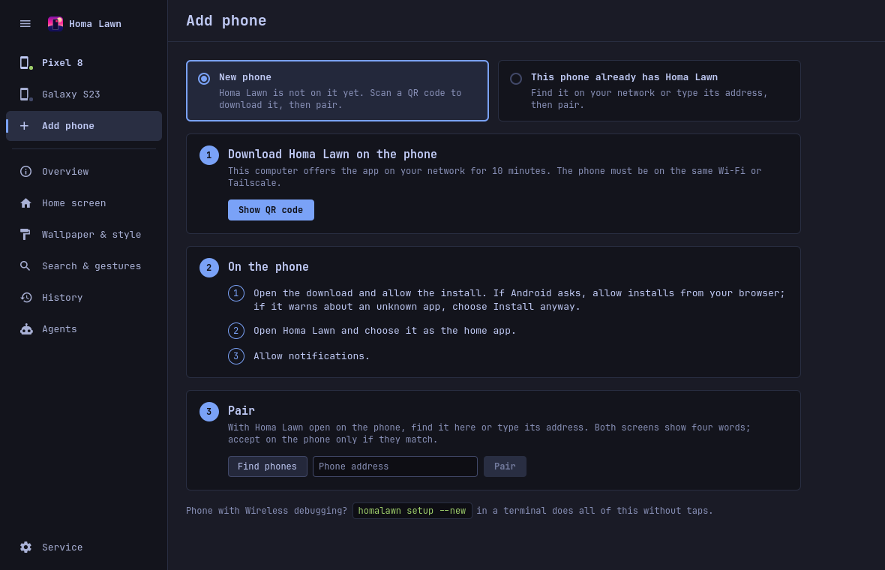
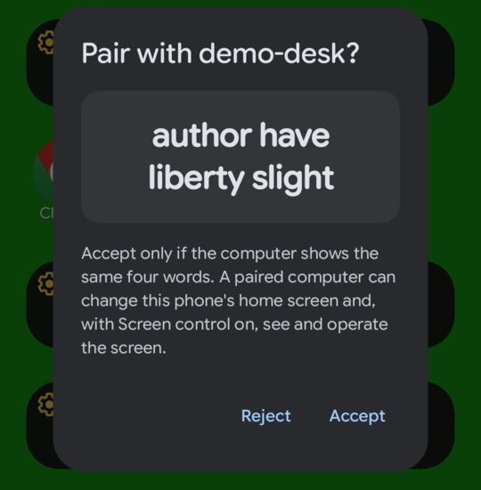
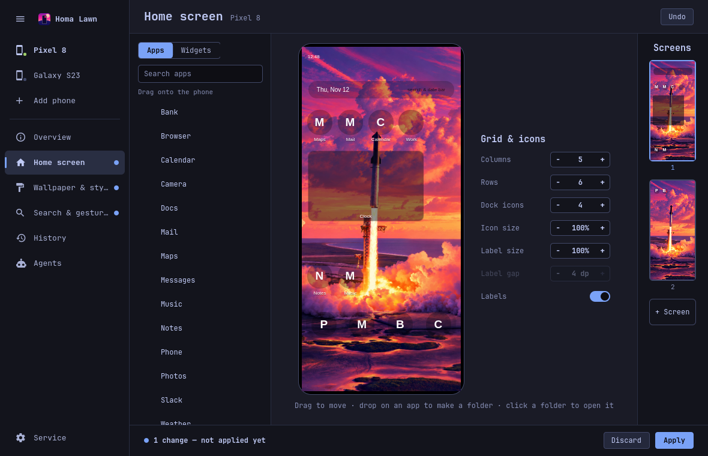

<p align="center">
  
</p>

<p align="center">
  <b>Run your Android phone's home screen from your Omarchy desktop: from a window, from the terminal, or through an AI agent.</b>
</p>

<p align="center">
  <a href="LICENSE"></a>
  
  
  <a href="https://github.com/g00rek/homalawn/actions/workflows/ci.yml"></a>
</p>

Homa Lawn is two things that work together: **an Android home screen app** (a build of the
open-source [Lawnchair](https://github.com/LawnchairLauncher/lawnchair) launcher with a small layer
on top) and **a desktop tool for [Omarchy](https://omarchy.org) Linux**. Once the phone and the
computer are paired, you can arrange the phone's apps, folders, widgets and grid from the computer,
let the phone take the wallpaper and colors of your Omarchy theme, undo any change, and let a coding
agent on the computer work with the phone. The two talk directly over your own network (or
Tailscale), encrypted, with no server in between, no cable and no developer options.

*The name:* **Hom**e + Om**a**rchy + **Lawn**chair.

<p align="center">
  
</p>

## Install

You need an [Omarchy](https://omarchy.org) computer and an Android phone on the same Wi-Fi (or the
same Tailscale network). It takes about ten minutes.

**1. Install the desktop tool.** With [uv](https://docs.astral.sh/uv/) (it fetches Python 3.12+
by itself):

```sh
uv tool install git+https://github.com/g00rek/homalawn.git
```

**2. Add Homa Lawn to the desktop.**

```sh
homalawn desktop install
```

This adds the Homa Lawn service (it runs in the background), the phone icon in Omarchy's bar with
its window, and Homa Lawn's tool server to the coding agents it finds on this computer (it lists
them; `--no-agents` skips that). It checks for `omarchy`, `omarchy-shell` and `systemctl` first and
changes nothing if one is missing. It is safe to run again.

**3. Open the window and add the phone.** Click the phone icon in the bar, then **Add phone ›
New phone › Show QR code**. Scan the code with the phone's camera. The phone downloads Homa Lawn
straight from the newest [GitHub release](https://github.com/g00rek/homalawn/releases) over HTTPS;
the code names that exact release file, which the computer downloaded and checked first (its SHA-256
and its signing certificate). Nothing has to be built.

**4. Tap through on the phone.** Open the download and allow the install (if Android asks, allow
installs from your browser; if Google Play Protect warns, choose **Install anyway**), open
**Homa Lawn**, choose it as the **home app**, and **Allow** notifications. Then, in Homa Lawn's
settings › **Permissions**, allow **Run in background**: without it Android cuts Homa Lawn's network
while the phone sleeps. Every tap is listed in [Setting up a phone](docs/guide/setup-phone.md).

**5. Pair.** Back in the window, press **Find phones** (or type the phone's address) and **Pair**.
Both screens show four words. If they match, tap **Accept** on the phone. Done: the phone appears in
the window's list.

<p align="center">
  
  &nbsp;
  
</p>

From a terminal, steps 3 to 5 are `homalawn update --download` (shows the QR code) and then
`homalawn pair`. For a phone with Wireless debugging switched on, `homalawn setup --new` does all of
it over adb: on the phone you only scan its pairing code and tap **Accept**.

## What you can do

**In the window** (click the phone icon in the bar):

- **Overview**: is the phone connected, which Homa Lawn it runs (with **Update app** when a newer
  release exists), which permissions it has given, and where the computer looks for it.
- **Home screen**: drag apps and widgets onto a picture of the phone, make folders, change the grid
  and the icon and label sizes.
- **Wallpaper & style**: let the phone follow your Omarchy theme (wallpaper cut to the phone's
  screen, launcher colors, light or dark, monochrome icons), or keep one theme.
- **Search & gestures**: what the app drawer's search shows and what home screen gestures do.
- **History**: every change is saved first; **Restore** puts the phone back to any point.
- **Agents**: ask your Omarchy coding agent to do things on the phone, and connect other agents.

Every editing page has one bar at the bottom: changes are a draft until you press **Apply**.

<p align="center">
  
</p>

**In the terminal**, the same things and more: `homalawn place`, `folder create`, `widget add`,
`grid`, `layout get/apply`, `wallpaper`, `undo`, `snapshot`, `prefs`, `nova-import` (move a Nova
Launcher home screen onto the phone), and `screen …` to read and operate any app's screen. See
[The `homalawn` command](docs/guide/cli.md).

**With an AI agent**: `homalawn mcp` gives a coding agent (Claude Code, Codex, Gemini and others)
typed tools for the home screen and, if you switch on **Screen control** on the phone, for any app's
screen. Every change is saved first and can be undone; the agent is told to leave passwords,
payments, installs and permission buttons to you. See [Agents](docs/guide/agents-mcp.md).

## Requirements

- **Computer**: Linux with Python 3.12 or newer (uv installs it) and `openssl` (it makes this
  computer's pairing key). The window, the bar icon and following the theme need
  [Omarchy](https://omarchy.org); the `homalawn` command and the agent tools work on any Linux.
  Optional: Avahi (`avahi-browse`) to find phones on the network by themselves (otherwise type the
  address), and `adb` only for `homalawn setup` and the adb route.
- **Phone**: Android 8.0 or newer. Tested on an Android 15 emulator and on Samsung phones on
  Android 16.

## Updating

- **The desktop tool**: `uv tool upgrade homalawn`, then `homalawn desktop install` again (it
  updates the service and the window in place).
- **The phone app**: when a newer release exists the window's Overview says **Update available**;
  press **Update app**. Or run `homalawn update`. With **Install updates** allowed on the phone, it
  installs by itself; otherwise tap the update notification on the phone, then **Update**.

## Uninstalling

```sh
homalawn desktop uninstall      # removes the service, the bar icon and window, and the agent entries
uv tool uninstall homalawn      # removes the homalawn command
```

Your pairings, this computer's key and the History stay in `~/.config/homalawn`,
`~/.local/share/homalawn`, `~/.local/state/homalawn` and `~/.cache/homalawn`; `desktop uninstall`
prints how to remove them. Forget the computer on the phone too (Homa Lawn's settings ›
**Computers** › the computer › **Forget**), or run `homalawn unpair` before uninstalling. On the
phone, pick another home app under Settings › Apps › Default apps › Home app, then uninstall
Homa Lawn like any app.

## How it works

```
 Omarchy computer                                        Android phone
┌──────────────────────────────────────────┐            ┌─────────────────────────────┐
│ omarchy-shell: bar icon and window       │            │ Homa Lawn                   │
│        │ local socket                    │            │ = Lawnchair 16 + patches/   │
│        ▼                                 │  mutual    │                             │
│ homalawnd service (follows the theme) ───┼── TLS ────▶│ link server, port 47100     │
│ homalawn command                      ───┤  pinned    │  home screen · settings ·   │
│ homalawn mcp (coding agents)          ───┤  certs     │  wallpaper · updates ·      │
│                                          │            │  screen control             │
└──────────────────────────────────────────┘            └─────────────────────────────┘
```

The phone app is upstream Lawnchair with a patch series (`patches/`) that adds a control layer
inside the launcher: an encrypted link server, writing the home screen in place, screen control
through an accessibility service, and app updates. The desktop package checks every change against
the phone's grid and saves a snapshot before it writes. More in
[Architecture](docs/development/architecture.md).

## Limits

Homa Lawn is **alpha**. It is used every day, but expect rough edges and changes.

- **It is built on Lawnchair 16's development branch** (the exact commit is in `patches/BASE`), not
  on a stable Lawnchair release.
- **Recents stay the phone's.** Android gives the recent-apps screen and its gestures to the
  phone's own launcher, so on a Samsung phone they stay One UI's. Homa Lawn runs the home screen and
  the app drawer.
- **Some wallpapers cannot be backed up** on Android 13 and newer: if the wallpaper was set on the
  phone itself, Android does not let Homa Lawn read it, so it cannot be saved before it is replaced.
  Homa Lawn asks **Replace current wallpaper?** first. See
  [Wallpaper & style](docs/guide/theme-sync.md#wallpaper-backups).
- **Screen control cannot see views apps mark as sensitive** (banking, passwords) on Android 14
  and newer.
- **The window and following the Omarchy theme need Omarchy.** The `homalawn` command and the agent
  tools work on any Linux.

## Security

The phone and the computer talk over TLS with pinned certificates; there is no cloud service. A
computer is paired only when a person taps **Accept** on the unlocked phone after comparing four
words, and an unpaired computer learns nothing about the phone. A paired computer can change the
home screen, settings and wallpaper and send Homa Lawn updates signed with Homa Lawn's key; it can
see and operate the screen only if you switch on **Screen control**. Remove a computer on the phone
(**Computers › Forget**) or on the computer (`homalawn unpair`). Details in
[Security and privacy](docs/guide/security.md); report vulnerabilities privately as described in
[SECURITY.md](SECURITY.md).

## Building from source

Optional: the tool downloads the phone app from the releases. To build it yourself you need a full
git clone of this repository, a Lawnchair clone in `lawnchair/`, JDK 21 and the Android SDK.
Without a signing key the build makes the test build, **Homa Lawn Test**
(`app.homalawn.debug`), which installs next to the release. A phone takes an update only when it is
signed with the same key as the Homa Lawn it has, so a phone running the official release cannot
take your own build (and the other way round) without uninstalling first. See
[Patching Lawnchair](docs/development/patching-lawnchair.md).

## Documentation

**Using Homa Lawn**

- [Setting up a phone](docs/guide/setup-phone.md): the QR code, the taps on the phone, pairing,
  permissions, addresses
- [The desktop window](docs/guide/desktop-window.md): bar icon, every section, the service
- [Wallpaper & style](docs/guide/theme-sync.md): following your Omarchy theme
- [The `homalawn` command](docs/guide/cli.md): every command, History and undo, Nova import
- [Agents (MCP)](docs/guide/agents-mcp.md): tools, safety rules, recipes
- [Troubleshooting](docs/guide/troubleshooting.md)
- [Security and privacy](docs/guide/security.md)

**Working on Homa Lawn**

- [Architecture](docs/development/architecture.md)
- [Patching Lawnchair](docs/development/patching-lawnchair.md): building, the patch policy, signing
- [Testing](docs/development/testing.md): unit tests, the emulator, the offscreen window
- [Releasing](docs/development/releasing.md)

## Contributing

Issues and pull requests are welcome. See [CONTRIBUTING.md](CONTRIBUTING.md) for the setup, the
tests, the Lawnchair patch policy and the commit style, and [CHANGELOG.md](CHANGELOG.md) for what
changed.

## License and credits

Homa Lawn is licensed under the [Apache License 2.0](LICENSE); see [NOTICE](NOTICE) and
[THIRD_PARTY_LICENSES](THIRD_PARTY_LICENSES).

- [Lawnchair](https://github.com/LawnchairLauncher/lawnchair) (Apache-2.0) is the launcher the
  phone app is built from; it builds on Launcher3 from the Android Open Source Project. The home
  screen, the app drawer, the icons and most of the phone's settings are the Lawnchair team's work.
- [Omarchy](https://omarchy.org) provides the desktop, omarchy-shell and the themes.
- [Flux](https://github.com/bjarneo/flux) (MIT) inspired the install-by-QR and update flow and the
  plugin update rules; code adapted from it is credited in [THIRD_PARTY_LICENSES](THIRD_PARTY_LICENSES).
- The four pairing words come from the [BIP-39 English word list](https://github.com/bitcoin/bips/blob/master/bip-0039/english.txt) (MIT).

Homa Lawn is an independent project. It is not affiliated with or endorsed by Lawnchair, Omarchy,
Nova Launcher, Samsung or Google.
