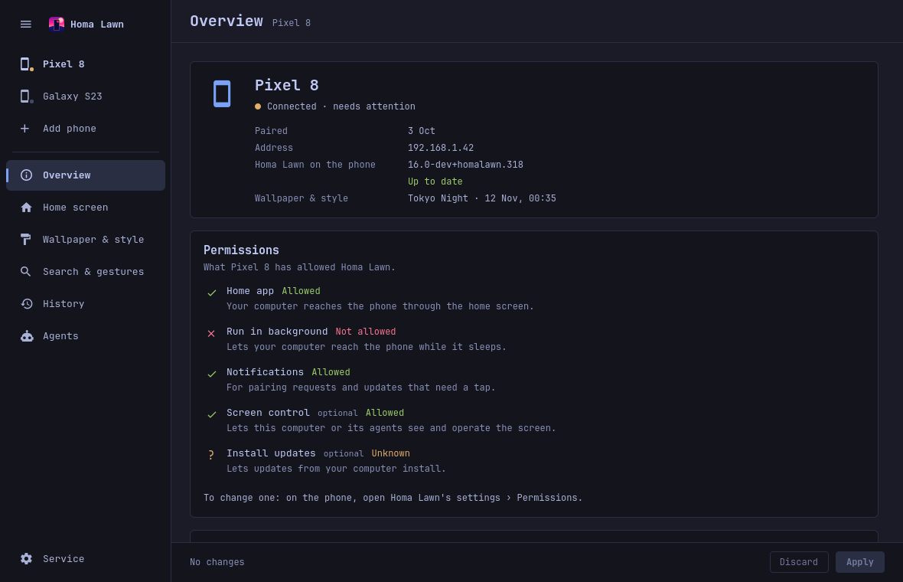
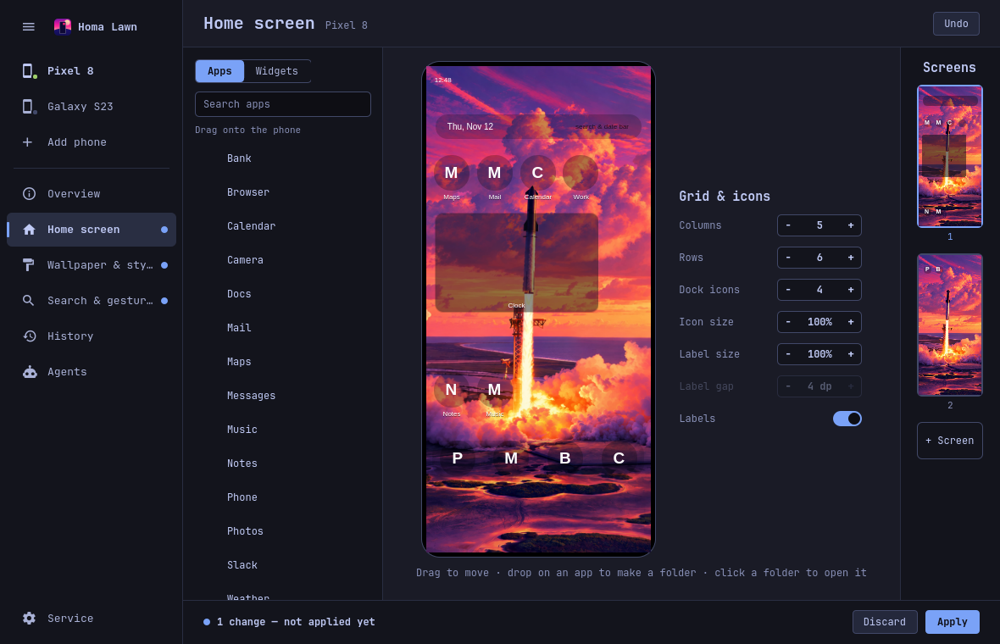

# The desktop window, bar icon and service

This guide covers what Homa Lawn adds to an Omarchy desktop: the bar icon, the Homa Lawn window
and each of its sections, and the background service behind them.

## Installing

```sh
homalawn desktop install      # safe to run again: it updates what is there
homalawn desktop uninstall    # takes it all out again; your pairings and History stay
```

`desktop install` first checks that `omarchy`, `omarchy-shell` and `systemctl` are on this computer
and stops with one sentence, having written nothing, if one is missing. Then it says each step as it
happens:

- it writes the systemd user unit **`homalawnd`** (running `homalawn serve`), starts it, and checks
  that it is running;
- it copies the Homa Lawn plugin to `~/.config/omarchy/plugins/homalawn/`, which puts the phone icon
  in the bar (it copies only changed files and keeps files you added);
- it adds Homa Lawn's tool server (`homalawn mcp`) to the coding agents it finds on this computer
  and names them. `--no-agents` skips that, now and for agents installed later; see
  [Agents](agents-mcp.md#connecting-a-coding-agent).

After upgrading the tool (`uv tool upgrade homalawn`), run `homalawn desktop install` again.

## The bar icon

The icon is the phone from Homa Lawn's picture. It is drawn in the theme's accent while a phone is
connected, muted when none is, dimmed while the service is not running, and in the warning color
when a phone needs attention (an error, or a needed permission is missing). Its tooltip lists each
phone (`Pixel 8 · connected`, `Pixel 8 · needs attention: run in background is not allowed`) and says
when an update is available. Click it to open or close the window.

The window can also be opened from a terminal or a key binding:

```sh
omarchy-shell shell toggle homalawn '{}'
omarchy-shell shell summon homalawn '{"page":"look"}'
```

`page` is one of `overview`, `home`, `look` (Wallpaper & style), `search`, `history`, `agents`,
`add` (Add phone) or `service`.

## The window

The rail on the left lists, from the top: your phones (name and a status dot), **Add phone**, a
divider, the selected phone's sections (**Overview**, **Home screen**, **Wallpaper & style**,
**Search & gestures**, **History**, **Agents**), and at the bottom **Service**. The **☰** button
folds the rail down to icons. A dot next to a section means it holds changes that are not applied
yet.

Three patterns hold on every page:

- **Apply.** Editing pages (Home screen, Wallpaper & style, Search & gestures, and Overview's
  addresses) have one bar at the bottom: **No changes**, or **N changes — not applied yet**, with
  **Discard** and **Apply**. Nothing reaches the phone before **Apply**. The phone picture shows a
  draft at once.
- **Confirm.** Actions that cannot simply be undone ask first, in a bar right where you pressed:
  the question, one line on what happens, **Cancel** and the action. Restore, Unpair, Replace
  current wallpaper, Update app and Restart all ask this way.
- **Undo.** Home screen, Wallpaper & style and Search & gestures have **Undo** in the header: it
  puts the phone back as it was before the last change, in one click; its tooltip says what that
  change was.

When the phone is offline, each page says so in one line: "<phone> is offline. Homa Lawn keeps
trying; changes apply when it is back." on pages where you can keep editing, or that the page needs
the phone connected. When the service is not running, every page shows one **Start** button.

### Overview



- **The phone**: connected or offline, when it was paired, its address, **Homa Lawn on the phone**
  with its version and **Up to date**, or **Update available: <version>** with **Update app**
  ("Update Homa Lawn on <phone>? Its home screen restarts."), the last **Wallpaper & style** applied,
  and the last error if there was one.
- **Permissions**: what the phone has allowed Homa Lawn: **Home app**, **Run in background**,
  **Notifications**, and the optional **Screen control** and **Install updates**, each **Allowed**
  or **Not allowed** with one line on what it is for. To change one, open Homa Lawn's settings ›
  **Permissions** on the phone ([details](setup-phone.md#permissions)).
- **Addresses**: where Homa Lawn looks for the phone, in the order it tries them. Type a name or
  address and **Add** it (the phone's Tailscale name reaches it away from home), or **Remove** one
  you added; then **Apply**. Addresses the phone reported itself are kept up to date by Homa Lawn.
  The technical tags are under **Details**.
- **Unpair**: forgets the phone here and tells the phone to forget this computer, after asking.

### Home screen



A picture of the phone's home screen, drawn from the phone's own measurements. Drag apps (or
widgets, from the **Widgets** tab) from the list onto the phone; drag an app onto another to make a
folder; click a folder to open it. **Grid & icons** sets columns, rows, dock icons, icon size, label
size, the gap between icon and label, and whether labels show. **Screens** on the right lists the
pages; **+ Screen** adds one. If the phone cannot take a layout, the cells it refused are marked
red and the bar says why.

### Wallpaper & style

The phone takes the wallpaper and colors of an Omarchy theme. **Source** (**Follow Omarchy**,
**Fixed theme** or **Off**), the **Wallpaper** for the lock screen and the home screen, and
**Colors & icons**. A preview of the lock and home screens shows the draft. Everything is in
[Wallpaper & style](theme-sync.md).

### Search & gestures

**Gestures**: what each home-screen gesture does (for example swipe down: notifications, or
"Search (instant)", app search with the keyboard up at once). **Search**: what the app drawer's
search shows (apps, contacts, files, web suggestions…) and whether the drawer opens with the
keyboard. Some sources need a permission on the phone, and the page says which.

### History

Homa Lawn saves the phone's state before every change it makes. History lists those saves, newest
first, each with a plain title such as **Home screen: 3 changes**, **Wallpaper & style: Tokyo
Night**, **Saved by hand: <name>** or **Before a restore**. **Restore** asks "Restore <phone> to
this point?" and puts it back; the state just before is saved first, so a restore can be undone
too.

### Agents

The header names the phone the agent works on.

- **Your agent**: a chat with your Omarchy default coding agent (Claude Code, Codex or Gemini). It
  works only through Homa Lawn's tools, and every change it makes is saved first. **Change default
  agent** opens Omarchy's menu.
- **Recent agent changes**: what agents changed on the phone, newest first, each with **Restore**.
- **Coding agents**: the agents installed on this computer and whether Homa Lawn's tool server is
  added to them; **Connect** adds it.
- **Recipes**: the written procedures agents follow for jobs inside other apps.

With no phone paired, the page offers **Add phone** instead of the chat.

### Add phone

Two paths:

- **New phone**: three steps. **1** Download Homa Lawn on the phone: **Show QR code** shows the
  address of the newest release's app file on GitHub (a build from this source checkout is offered on
  your network for 10 minutes instead); scan the code with the phone's camera. **2** On the phone:
  allow the install, open Homa Lawn and choose it as the home app, allow notifications. **3** Pair.
  Below it, for phones with Wireless debugging: `homalawn setup --new` in a terminal does all of it
  without taps.
- **This phone already has Homa Lawn**: open Homa Lawn on the phone, then **Find phones** or type
  its address, and **Pair**. Both screens show four words; accept on the phone only if they match.

The full walk-through, tap by tap, is in [Setting up a phone](setup-phone.md).

### Service

Whether the Homa Lawn service runs ("Running since …"), its version and the phones it serves, with
**Restart**. The socket and build are under **Details**.

## The service

`homalawnd` is a systemd user service running `homalawn serve`. It keeps a link to each paired
phone, applies Wallpaper & style when the Omarchy theme or background changes (also with the window
closed), adds Homa Lawn's tool server to coding agents installed later, and answers the window over
a local socket (`$XDG_RUNTIME_DIR/homalawn/homalawnd.sock`, or `HOMALAWN_SOCKET`) that only your own
user may open. The socket protocol is in [architecture.md](../development/architecture.md#the-desktop-service).

```sh
systemctl --user status homalawnd
journalctl --user -u homalawnd -f
```
