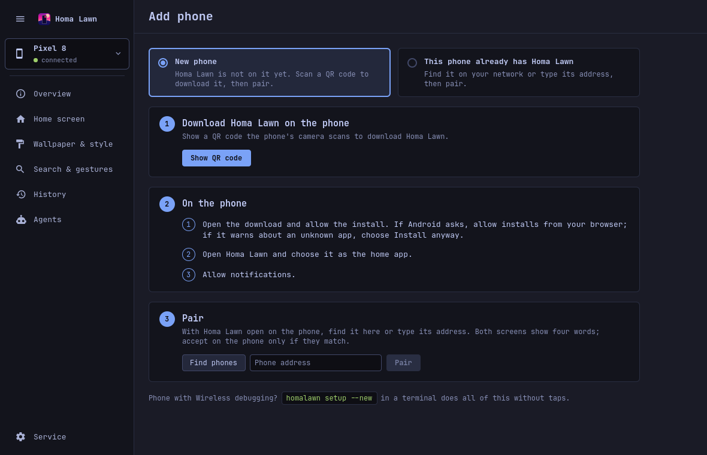
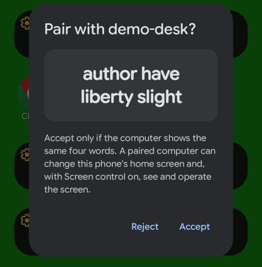
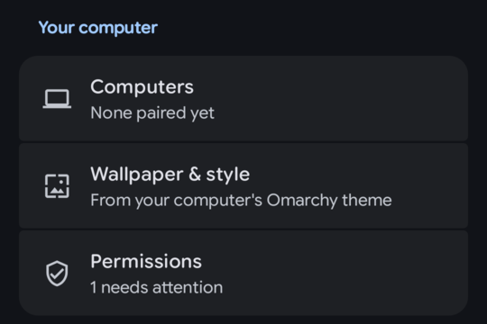
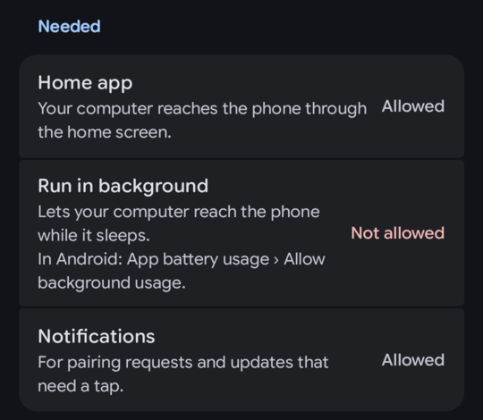

# Setting up a phone

This guide covers getting Homa Lawn onto an Android phone, every tap on the way, pairing it with
your computer, the permissions it needs, and how the computer finds the phone.

There are two ways in:

- **[By QR code](#by-qr-code-recommended)** (recommended): the phone downloads Homa Lawn from its
  GitHub release page over HTTPS. No developer options, no cable, nothing to build.
- **[With Wireless debugging](#with-wireless-debugging-homalawn-setup)**: `homalawn setup` does
  everything over adb, for phones where developer options are already on (test phones, emulators).

Either way the phone and the computer then [pair](#pairing) once. From then on they talk over
Homa Lawn's own encrypted link, which survives reboots, sleep, app updates and network changes.

Before you start, install the desktop tool and add it to Omarchy (see the
[README](../../README.md#install)):

```sh
uv tool install git+https://github.com/g00rek/homalawn.git
homalawn desktop install
```

## By QR code (recommended)

### 1. Show the QR code

In the Homa Lawn window (click the phone icon in the bar): **Add phone › New phone › Show QR code**.
With no phone paired yet, Add phone is the window's first screen.



The code is the HTTPS address of the app file in the newest
[GitHub release](https://github.com/g00rek/homalawn/releases): the phone downloads it straight from
GitHub, so it only needs internet access, and the code does not expire. The computer names that exact
release file, and only after downloading it once and checking that its SHA-256 matches the release
and it is signed with Homa Lawn's release key (see
[Security](security.md#release-builds-and-their-signature)). The page also shows the address as text
and the version; **Stop** takes the code away.

When you run Homa Lawn from a source checkout that holds a build of the phone app, that build is
offered instead, from this computer: over plain HTTP on your own network for **10 minutes**, on port
47101, at an address with a random part that only the QR code carries. That route is meant for your
own builds; the phone must be on the same Wi-Fi as the computer, or on the same Tailscale network.

From a terminal the same thing is:

```sh
homalawn update --download          # the QR code and the GitHub address (a build of your own: served 10 minutes; Ctrl+C stops it)
```

For a build served from this computer: if the computer runs the ufw firewall and it blocks port 47101, the command prints the one
`sudo ufw allow …` line that opens it for your network.

### 2. The taps on the phone

Labels as Chrome and Android show them; Samsung phones and Samsung Internet word some of them
differently.

1. Scan the QR code with the camera and open the link (or type the address into the browser).
2. "File might be harmful": **Download anyway**.
3. "File downloaded": **Open**. (If the bar is gone: Chrome's **⋮** menu › **Downloads** › tap the
   file.)
4. The first time only, "…isn't allowed to install unknown apps from this source": **Settings**,
   switch on **Allow from this source**, go back, and tap the file again.
5. "Do you want to install this app?": **Install**.
6. If Google Play Protect says the app is unknown or blocks it: **More details** ›
   **Install anyway**. (Homa Lawn is not on the Play Store, so Play Protect does not know it.)
7. On a Samsung phone, if the install is blocked outright, **Auto Blocker** is on: Settings ›
   Security and privacy › **Auto Blocker**, turn it off for the install, then tap the file again.
   You can turn it back on afterwards.
8. "App installed": **Open**.
9. Homa Lawn asks to be the home app: choose **Homa Lawn**, then **Set as default**.
10. "Allow Homa Lawn to send you notifications?": **Allow**.
11. Open Homa Lawn's settings (the **Homa Lawn** icon in the app drawer) › **Permissions** and tap
    **Run in background**. Android asks "Let app always run in background?": **Allow**. On a
    Samsung phone, also add Homa Lawn to **Never auto sleeping apps** (in Samsung's battery settings, under Background usage limits). [Why this matters](#run-in-background).

Your previous launcher stays installed. To go back to it, pick it under Settings › Apps › Default
apps › Home app.

### 3. Pair

In the window, under **3 Pair**: **Find phones** (or type the phone's address) › **Pair**. Then
follow [Pairing](#pairing) from step 3.

## Pairing

1. **On the phone**, unlock it and leave Homa Lawn's home screen showing. While it shows, Homa Lawn
   takes a computer's pairing request by itself. If you cannot have the home screen showing, open
   Homa Lawn's settings › **Computers** › **Pair a computer** instead: the screen says
   **Waiting for a computer…** and stays open for 5 minutes.
2. **On the computer**, in the window: **Add phone** › **Find phones** (or type the address) ›
   **Pair**. Or in a terminal:

   ```sh
   homalawn pair                    # looks for the phone on this network
   homalawn pair 192.168.1.50       # or give its address (LAN or Tailscale; port 47100 by default)
   ```

   If the phone is not taking requests yet, the computer says how to open pairing on the phone and
   keeps asking for 5 minutes.
3. **The phone shows "Pair with <computer>?"** and four words; the computer shows the same four.
   If they match, tap **Accept**. If they differ, tap **Reject**: something is in between.



After **Accept** both sides remember each other; the window selects the new phone. The comparison
happens on the phone, so look at the words before tapping. More on what pairing protects in
[Security](security.md#pairing-needs-a-person-on-the-phone).

**Several computers.** A phone can be paired with more than one computer. Homa Lawn's settings ›
**Computers** lists them (**Online now**, **Last seen …** or **Not seen yet**); tap one to see its
details and **Forget** it. **Forget all computers** removes every one.

**Several phones.** A computer can be paired with several phones; `homalawn phones` lists them and
the window's phone picker (the button at the top of the rail) lists them.

**Unpairing.** On the computer: **Unpair** on the window's Overview, or `homalawn unpair NAME`. Both
sides forget each other (when the phone is reachable; otherwise the phone is told at its next
contact). On the phone: **Forget** in Computers.

## Homa Lawn's settings on the phone

Open them from the **Homa Lawn** icon in the app drawer. They have three groups:

- **Your computer**: **Computers** (paired computers and **Pair a computer**), **Wallpaper & style**
  (what the phone takes from your computers' Omarchy themes; see
  [Wallpaper & style](theme-sync.md#on-the-phone)) and **Permissions**.
- **Launcher**: Lawnchair's own settings (General, Home screen, Dock, App drawer…), untouched.
- **About**: the version and build number, links to the project, open-source licenses and credits.



### Permissions

**Permissions** shows everything Homa Lawn needs from Android, whether it is **Allowed** or
**Not allowed**, and why. Tapping a row opens the exact Android page.



| Row | Needed? | What it is for |
|---|---|---|
| **Home app** | Needed | Your computer reaches the phone through the home screen. |
| **Run in background** | Needed | Lets your computer reach the phone while it sleeps. In Android: App battery usage › Allow background usage. |
| **Notifications** | Needed | For pairing requests and updates that need a tap. |
| **Screen control** | Optional | Lets a paired computer or its AI assistant see and operate the screen. In Android: Accessibility › Downloaded apps › Homa Lawn › Use Homa Lawn. |
| **Install updates** | Optional | Lets updates from your computer install without a tap ("Install unknown apps" for Homa Lawn). |

The settings row says **All set** or how many needed ones are missing. While one is missing, a
**Setup reminders** notification asks once; tapping it opens this screen. The window's Overview
shows the same list for each phone.

#### Run in background

Homa Lawn keeps no permanent notification, so Android treats it like any app in the background.
**If "Run in background" is not allowed, Android cuts Homa Lawn's network while the phone sleeps,**
and the computer shows the phone as **offline** until someone picks the phone up. Allowing it
(Android's battery-optimization exemption) fixes that. Samsung phones put apps to sleep on their
own as well, so on Samsung also add Homa Lawn to **Never auto sleeping apps** (in Samsung's battery settings, under Background usage limits).

#### Screen control and "Restricted setting"

Screen control is Homa Lawn's accessibility service. It is off until you switch it on, and you can
switch it off at any time in Android's Accessibility settings. For an app installed from a browser,
Android 13 and newer may grey it out with **Restricted setting**. Then: Settings › Apps ›
Homa Lawn › **⋮** › **Allow restricted settings**, and try again.

## With Wireless debugging (`homalawn setup`)

One command takes a phone with developer options on to "set up, paired and checked":

```sh
homalawn setup --new      # a phone this computer has never seen: straight to the adb pairing QR code
homalawn setup            # a phone already on adb, or one already set up (safe to run again)
```

It connects adb over Wireless debugging by QR code, installs Homa Lawn (from `--apk FILE`, else a
build in this checkout, else the newest release), makes it the home app, lets it run in the
background, allows its notifications, switches screen control on (running setup is your consent;
`--no-screen-control` leaves it off), pairs the link and checks that it all works. It ends with
**Ready: <phone> is set up and paired.** Wireless debugging can be turned off afterwards: the link
does not need it.

The taps on the phone:

1. Once: Settings › About phone › tap **Build number** seven times to turn on developer options.
2. Settings › Developer options › **Wireless debugging** › **Pair device with QR code**, and scan
   the code the terminal shows (it is also opened as a picture on the desktop).
3. If Play Protect or an install prompt appears, answer it (**Install anyway**). On Samsung, Auto
   Blocker blocks adb installs: turn it off for the install.
4. Leave the home screen showing; "Pair with <computer>?" appears. If the four words match the
   terminal's, tap **Accept**.

If adb's network discovery is off, setup asks instead for the address and six-digit code from
"Pair device with pairing code", then the address under "IP address & Port".

`--serial SERIAL` picks one of several adb devices. `--via link` checks and updates a phone that is
already set up over the link only.

## Addresses: LAN, Tailscale, adb

The computer remembers each phone's addresses and tries them in this order: the address that
answered last, the last LAN address that answered, the addresses you added (at most 5), the
Tailscale addresses the phone reported (only when this computer is on Tailscale too), the address
it paired through, and finally a search of the local network (Avahi). The phone's certificate
decides whether the right phone answered, never the address.

To reach a phone away from home, add its Tailscale name or address. In the window: **Overview ›
Addresses**, type it, **Add**, **Apply**. In a terminal:

```sh
homalawn addresses                          # where the phone is looked for, and what answered last
homalawn addresses add pixel-8.tailnet.ts.net
homalawn connect 100.64.0.10                # try it now, and add it when it answers
```

The phone also reports its Tailscale addresses at every connection, so a phone on your tailnet is
usually found without typing anything.

**adb** is a second way to reach a phone, over Wireless debugging or USB. Homa Lawn falls back to it
when the link does not answer, and it can do a few things the link cannot (set the home app back
after a crash, allow reading the current wallpaper for one backup).

```sh
adb pair 192.168.1.50:PAIRPORT              # first time only, with the code from Wireless debugging
homalawn connect 192.168.1.50:PORT
```

How a command picks the phone and the way to reach it is in [cli.md](cli.md#which-phone-and-how).

## Files on the computer

| What | Where |
|---|---|
| Settings (`config.toml`, `look.json`) | `~/.config/homalawn/` (`HOMALAWN_CONFIG` names the `config.toml` file; the rest lives next to it) |
| This computer's key and the paired phones (`key.pem` mode 600, `cert.pem`, `peers.json`) | `~/.config/homalawn/link/` |
| History (snapshots) | `~/.local/share/homalawn/snapshots/` (`HOMALAWN_DATA` names the folder above it) |
| The service's working files, agent registrations, the Agents chat | `~/.local/state/homalawn/` (`HOMALAWN_STATE_DIR`) |
| Downloaded phone app | `~/.cache/homalawn/apk/` |
