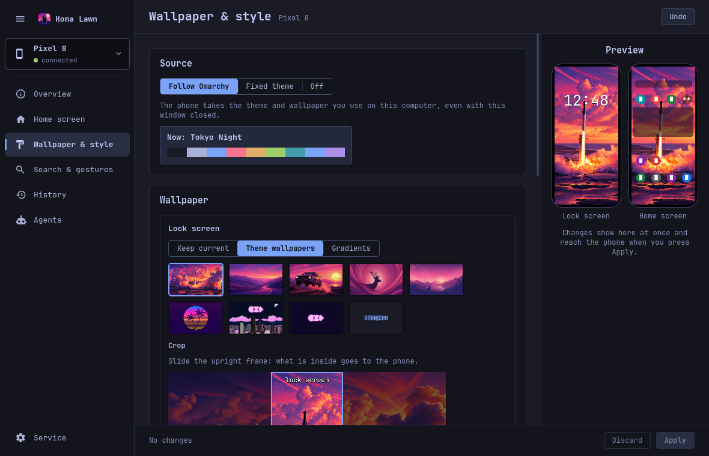

# Wallpaper & style

This guide covers Wallpaper & style: how the phone takes the wallpaper and colors of an Omarchy
theme, in the window, on the phone and from the terminal, and what Undo can bring back.

A word on names: **theme** means an Omarchy theme, the source. What the phone gets from it (the
wallpapers, how they are cropped, darkened or lightened, the launcher colors, light or dark mode,
the icon style) is its **wallpaper & style**.



## In the window

Open the window from the bar icon, choose the phone with the picker at the top of the rail, then **Wallpaper & style**. The
settings are per phone. Everything you change is a draft that the preview on the right shows at
once; nothing reaches the phone until you press **Apply** in the bar at the bottom (**Discard**
drops the draft).

### Source

- **Follow Omarchy**: the phone takes the theme and wallpaper you use on this computer. When you
  switch the Omarchy theme or background, the phone follows within seconds, even with the window
  closed (the Homa Lawn service does it). The card shows the theme in use now and its colors.
- **Fixed theme**: pick a theme; the phone keeps it whatever the computer uses.
- **Off**: Homa Lawn leaves this phone's wallpaper & style alone.

### Wallpaper

Two panels, **Lock screen** and **Home screen**, each with its own choice:

- **Keep current**: this screen keeps the wallpaper it has now.
- **Theme wallpapers**: one of the theme's backgrounds. Under **Crop**, slide the upright frame
  across the picture to choose what the phone shows; for the home screen the frame covers every
  home-screen page, and faint lines show where each page starts.
- **Gradients**: six gradients made from the theme's colors.

**Darken / lighten** puts a layer over the picture. For the home screen, **Parallax** makes the
wallpaper move as you swipe between pages.

### Colors & icons

- **Launcher colors**: the accent, folders, dock and app list take the theme's palette.
- **Light / dark from the theme**: the launcher follows whether the theme is light or dark.
- **Monochrome icons**: every icon in one theme color on a plain plate; **Icon color** picks which.
  It is a separate switch because apps draw their own monochrome layer, which not every app has.

A theme without a color palette sends only its wallpaper.

### Undo

One Apply is one entry in History (for example **Wallpaper & style: Tokyo Night**). **Undo** in the
header (or `homalawn undo`) puts the previous wallpapers and colors back together.

The first time, Homa Lawn may need access to photos on the phone to save the current wallpaper;
Android asks on the phone.

## On the phone

Homa Lawn's settings › **Wallpaper & style** shows what the phone takes from your computers.

- The first line says what is on screen now, for example "On screen: Laptop's wallpaper & style".
- **Source**: **Latest change** follows the computer whose wallpaper & style changed last; or pick
  one paired computer and the phone shows only its wallpaper & style, whatever the others do. This
  matters only when the phone is paired with more than one computer: each computer's wallpaper &
  style is kept on the phone, and Source picks which one shows.
- **Lock screen** and **Home screen** panels: for each, keep the current wallpaper, pick one of the
  theme's wallpapers, or a gradient made from its colors, with a darken / lighten layer.

As in the window, your choice is a draft until you press **Apply** at the bottom. With no computer
paired the screen says **Pair a computer first** and offers **Open Computers**; when a computer has
not sent its wallpapers yet, it says to open Homa Lawn on that computer.

When a computer's wallpaper & style is not the one on screen, its window says which computer's the
phone shows, and that this computer's is kept on the phone for later. Forgetting or unpairing a
computer removes its wallpaper & style from the phone.

## From the terminal

```sh
homalawn look show                     # this phone's Wallpaper & style settings, as JSON
homalawn look apply                    # apply them now
homalawn --phone "Pixel 8" look apply  # with several phones paired
homalawn wallpaper ~/Pictures/wall.png --both --crop center   # a one-off picture, no theme
```

The settings themselves are changed in the window; they are kept per phone in
`~/.config/homalawn/look.json`.

## Wallpaper backups

Every wallpaper change first saves the picture it replaces, so it can be undone.

- When Homa Lawn set the current wallpaper itself, it still has that picture, and the save needs
  nothing from the phone.
- When the wallpaper was set on the phone itself (in the Gallery, or another app), Homa Lawn has to
  read it from the phone. **Android 13 and newer do not let a launcher read the current wallpaper.**
  The window and the phone then ask **Replace current wallpaper?** ("The wallpaper set on this phone
  can't be backed up, so Undo can't bring it back."): **Replace** goes ahead, **Cancel** keeps your
  draft. In a terminal the command stops with one line: run that one change with `--via adb` (over
  adb Homa Lawn can allow the read for that one call) or add `--no-backup`. After that, Homa Lawn
  set the wallpaper, so later backups work again.
- A live wallpaper cannot be saved; it is replaced only with `--no-backup` (or **Replace**).

Setting only the home wallpaper while the lock screen shows the same picture leaves the old picture
on the lock screen (Android does that); set both.
